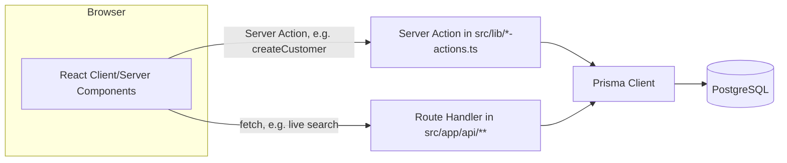
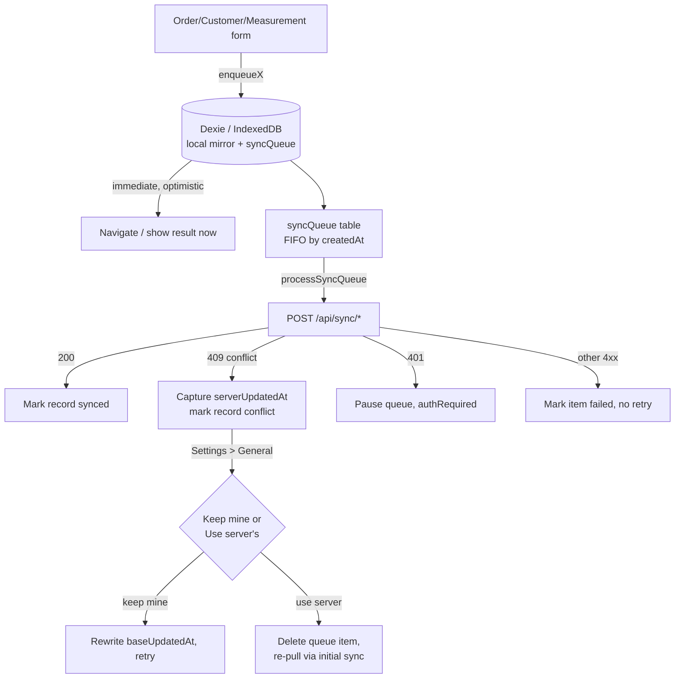

# Sui Dhaga — Technical Handover Document

**Audit date:** 2026-11-08
**Audited at commit:** `d5c36ed` (branch `main`, up to date with `origin/main`, working tree clean at time of audit)
**Audit method:** Direct inspection of the current source tree, `git log`/`git show`, Prisma schema and migration SQL, and the project's own inline code comments (which this codebase uses extensively to document *why*, not just *what*). No destructive command was run. No database was written to, reset, or seeded during this audit. No application code was modified.

**How to read the status tags used throughout this document:**

| Tag | Meaning |
|---|---|
| ✅ Verified (static) | Confirmed by directly reading the current source code / schema / migrations. This is **not** the same as a passing automated test — see the global caveat below. |
| ✅ Verified (live) | Confirmed by actually running something during this audit (e.g. `npx tsc --noEmit`, `git status`). |
| ⚠️ Partially implemented | Code exists but has a documented gap, asymmetry, or edge case. |
| ❓ Unverified | Plausible from adjacent evidence but not directly confirmed by reading the responsible code. |
| ❌ Not implemented | Mentioned as a goal somewhere but no implementing code found. |

**Global caveat — please read before trusting any "verified" tag below:** No automated test suite files (`test-step*.mjs`, `test-phase*.mjs`) exist anywhere in this repository. The test *infrastructure* (isolated test database, isolated test server, test runner, safety guard) is real, inspectable, and working (see Part 6). But every actual test file that code comments reference (e.g. "`test-phase6.mjs`", "`test-step64.mjs`") was an ephemeral artifact of a past AI coding session's scratch directory — never committed to this repo, and not available now. **Nothing in this document should be read as "a test proved this works."** Every functional claim below is "the code, as currently written, appears to implement X" — verified by reading, not by execution, unless explicitly marked "Verified (live)".

---

## Part 1 — Project Overview

**Name:** Sui Dhaga ("needle and thread") — Digital Management System
**Purpose:** A single-admin management app for a tailoring shop (per `README.md:3-7`): customers, their body measurements, stitching orders, a work-order/receipt print workflow for the tailor and the customer, and a WhatsApp handoff for status updates. It is a PWA — the shop floor can keep searching customers and taking orders while offline, and queued writes sync when connectivity returns.

**Target users / workflow:** One admin user (there is no multi-user/role system — `Phase 1` comments at `auth-actions.ts:3`, `middleware.ts:4`, `schema.prisma:365` are explicit that this is deliberately single-tenant, single-shop, single-admin). The real-world workflow this models: a customer walks in → admin searches/creates their record → takes body measurements → places an order for one or more suits with style choices → prints a Karigar (tailor) work order and/or a customer receipt → updates order status as it moves through stitching → messages the customer on WhatsApp → records delivery and payment.

**Main problems it solves:**
- Replaces a paper ledger for customer measurements and order tracking.
- Makes "which orders are overdue / due today / ready / still owed money" a one-glance board instead of manual lookup.
- Produces a bilingual print workflow: Urdu/RTL work orders for the tailor (with photos of each style choice, since literacy/language varies on the shop floor), English receipts for the customer.
- Keeps working when the shop's internet is unreliable, via an offline-first local mirror that queues writes.

**Technology stack (actual installed versions, confirmed by reading `node_modules/*/package.json` directly, not just `package.json` ranges):**

| Package | Installed version |
|---|---|
| next | 14.2.15 |
| react / react-dom | 18.3.1 |
| @prisma/client / prisma | 5.20.0 |
| dexie | 4.4.5 |
| lucide-react | 1.47.0 |
| zod | 3.23.8 |
| bcryptjs | 2.4.3 |
| typescript | 5.6.3 |
| tailwindcss | 3.4.13 |
| eslint | 8.57.1 |
| Node.js (dev machine) | v24.18.1 |
| npm | 11.16.0 |

Database: PostgreSQL (README states "14+" as the tested requirement; this audit did not query the live server's version to avoid any DB interaction — label this **❓ Unverified**, documented-only).

**Project directory structure** (confirmed via full file listing, excluding `node_modules`/`.next`/`.git`):

```
prisma/          schema.prisma, 4 migrations, seed.ts
public/          sw.js (hand-written service worker), manifest icons, 22 design-option .jpeg photos
scripts/         isolated test-db + test-server + test-runner tooling (own README.md)
src/app/         Next.js App Router routes: pages, loading/error/not-found boundaries, /api/sync/* and /api/search/* route handlers
src/components/  UI, grouped by domain: customers/, orders/, measurement/, print/, search/, offline/, backup/, whatsapp/, ui/ (primitives)
src/lib/         Server Actions, domain/business logic, offline/ (Dexie + sync engine), locale/en.json
src/middleware.ts  session-based route protection
```

**Important dependencies and their purposes:**
- **Prisma 5 / PostgreSQL** — the single source of truth; all Server Actions and `/api/sync/*` route handlers ultimately write here.
- **Dexie 4 (IndexedDB wrapper)** — the offline-first local mirror and sync queue (`src/lib/offline/db.ts`).
- **Zod** — input validation in Server Actions (e.g. `order-actions.ts`'s `orderInputSchema`).
- **bcryptjs** — password hashing for the single admin account.
- **lucide-react** — icon set (e.g. the `Trash2` delete icon, `SlidersHorizontal` settings icon).
- **Tailwind CSS** — all styling; no CSS-in-JS.
- No ORM-adjacent testing framework (Jest/Vitest/Playwright) is installed — see Part 6.

**Development environment / setup requirements:** Node 18.17+ (README; tested on 18.20, though this audit's machine runs Node 24), a reachable PostgreSQL 14+ instance, and a `.env` populated from `.env.example` (`DATABASE_URL`, `SESSION_SECRET`, `SEED_ADMIN_EMAIL`, `SEED_ADMIN_PASSWORD` — see Part 5 for the exact setup commands). ✅ Verified (static): `.env.example`, `.env`, and `.env.test` all exist and share the same 4 variable names (values not read, per the audit's own rules).

---

## Part 2 — Complete Development History

### 2.1 What the evidence actually allows us to reconstruct

This project's git history is **heavily squashed** — only 4 commits exist total, so git does **not** give one commit per development step:

| Hash | Author | Date | Subject |
|---|---|---|---|
| `b7f1fad` | Hamza | 2026-09-08 | Initial project setup |
| `f50adf9` | Hamza | 2026-09-24 | Update Sui Dhaga application (no body — subject only) |
| `20fd6af` | Hamza (co-authored Claude Sonnet 5) | 2026-10-03 | Add order delete icon to All Orders; fix multi-suit pricing, Collar/Bain, and Work Order print layout |
| `d5c36ed` | Hammad.Insight (co-authored Claude Opus 5, 1M context) | 2026-11-07 | Revamp UI shell; fix search, a11y, and offline-sync dead ends |

The real step-by-step history lives in this codebase's own **inline comments**, which very consistently cite a "Step N" or "Phase N" label when a piece of logic was added or changed, and often explain *why* a change was made and what it corrected. This is a genuinely useful and unusually rich source — but it has a hard limit: a comment tells you **what** a step did and **where one piece of evidence for it lives**, not the **complete list of every file that step touched**. Without per-step commits, a full "files created / files modified / files deleted" breakdown per step (as requested) is **not reconstructable** for any step except the two real, un-squashed commits (`20fd6af` and `d5c36ed`), for which full `git show --stat` file lists exist and are used below.

**Two numbering tracks exist in parallel:** a continuous "Step N" track (the main feature build-out) and a separately-numbered "Phase 1–12" track specifically for the offline-first/PWA initiative, which cross-references show ran *interleaved with*, not strictly before or after, the Step track (e.g. a Step 56 comment references "Phase 11"; a Step 53 comment is described in a Phase 6 comment).

### 2.2 Chronological table (Steps)

| Step | Topic | Primary evidence | Notes |
|---|---|---|---|
| 1 | Original Prisma schema/architecture | `schema.prisma:4,10,22` | Foundational. |
| 2 | Referenced only as "Step 2+" re: money arithmetic | `schema.prisma:223` | Gap — `money.ts` itself has no "Step" language. |
| 3 | Customer CRUD Server Actions; legacy internal customer list | `customer-actions.ts:3`, `src/app/customers/page.tsx:15` | |
| 4 | Original customer-search algorithm (later superseded by Step 11, then Step 56) | `customer-search.ts:3` | |
| 5 | Measurement Server Action / value-regex | `measurement-actions.ts:3`, `measurement-value.ts:5` | |
| 6 | Original Order Server Actions ("rebuilt in Step 14") | `order-actions.ts:3` | |
| 7 | Old stat-card dashboard content (fully replaced by Step 46) | `src/app/dashboard/page.tsx:18` | |
| 8 | Schema "audit" that identified the need for Step 9 | `schema.prisma:4,18` | |
| 9 | **MeasurementSnapshot / OrderItem / ShopSettings** — major schema expansion; migration `20260830111733_step9_...` | `schema.prisma:21-23,206-220,263-296` | Confirmed via migration SQL (Part 5). |
| 10 | Design-system typography foundation; shared nav/search/logout bar | `src/app/layout.tsx:12`, `login/page.tsx:12` | |
| 11 | S1 Search/Home screen, replacing Step 4 | `customer-search.ts:3`, `dashboard/page.tsx:17` | Itself later substantially rewritten by the Nov 7 commit (§2.4). |
| 12 | S2 Customer Profile screen | `customers/[customerId]/page.tsx:23` | |
| 13 | Measurement fraction-glyph input rebuild | `fractions.ts:1` | |
| 14 | Order form/detail rebuild; multi-suit/snapshot graph populated; order-draft autosave | `order-actions.ts:5-8`, `measurement-draft-storage.ts:6` | |
| 15 | S4 Order Board | `src/app/orders/page.tsx:39`, `date-range.ts:2` | |
| 16 | Print receipt/work-order entry points | `receipt/page.tsx:13` | |
| 17 | WhatsApp composer | `whatsapp-composer.tsx:3` | |
| 18 | S6 Settings placeholder | `settings/page.tsx:19` | |
| 19 | Manual Backup/Export Server Actions + CSV builder | `backup-actions.ts:3`, `csv.ts:1` | |
| 20 | Legacy customer list restyled onto Step 10 design system | `customers/page.tsx:16` | |
| 21 | Global keyboard shortcuts | `global-shortcuts.tsx:3` | |
| 22 | Karigar Work Order print preview (Urdu/RTL) | `work-order/page.tsx:32` | |
| 23 | Work order 2-per-A4-landscape layout with cut guide | `work-order/page.tsx:33` | |
| 24 | "Send on WhatsApp" checkbox on print-preview | `print-preview/page.tsx:75` | |
| 25 | Combined new-customer+order fast flow | `customer-order-actions.ts:3` | |
| 26 | Live phone-input mask | `phone-input.tsx:3` | |
| 27 | Audit flagging gaps fixed by Steps 28/31/34 | `backup-status.ts:6` | |
| 28 | Fixed measurement-prefill source gap from Step 27 | `measurement-prefill.ts:1` | |
| 29 | S5 Print Preview screen | `print-preview/page.tsx:15` | |
| 30 | Not located | — | Gap. |
| 31 | Soft-deleted-customer fallback routing | `customer-actions.ts:107,137,171` | |
| 32 | S1 "Customer only" action | `customers/new/page.tsx:14` | |
| 33 | Not located | — | Gap. |
| 34 | Settings gains Backup + Language sections | `settings/page.tsx:27-28` | |
| 35 | "Last successful backup" indicator | `backup-status.ts:1` | |
| 36/37 | Print numeral size fix; WhatsApp Urdu template prose | `measurement-snapshot-print-grid.tsx:70`, `whatsapp.ts:12` | |
| 38 | Ctrl+P "save and print" on new-order form | `global-shortcuts.tsx:21` | |
| 39/40 | Not located | — | Gaps. |
| 41 | Decorative measurement silhouette | `order-measurement-block.tsx:209` | |
| 42 | Not located | — | Gap. |
| 43 | Audit finding re: Recent Orders / dashboard | `overview/page.tsx:30` | |
| 44 | "Redesign plan" — only referenced secondhand by Step 46 | `tailwind.config.ts:62` | Gap — own origin not found. |
| 45 | `/overview` Dashboard placeholder + middleware protection | `middleware.ts:8` | |
| 46 | Real Dashboard; `StatCard`/`SectionCard` primitives | `overview/page.tsx:19`, `stat-card.tsx:3` | |
| 47 | Dashboard stat cards become clickable links; "outstanding" tab | `stat-card.tsx:12`, `orders/page.tsx:13,79` | |
| 48 | Customer Profile identity header → bordered card | `customers/[customerId]/page.tsx:29` | |
| 49 | `SectionCard` adopted for Order Form; editable-status tint | `section-card.tsx:5`, `status-badge.tsx:4,14` | |
| 50 | **Per-suit style override** — major; migration `20260913100220_step50_...`; login redirect change; new/delivered tabs | `auth-actions.ts:99`, `orders/page.tsx:19,94` | Confirmed via migration SQL. |
| 51 | Settings-menu icon-button replaces old header area | `settings-menu.tsx:3` | |
| 52 | Not located | — | Gap. |
| 53 | **Edit Order** feature | `order-build.ts:112`, `.../edit/page.tsx:37` | |
| 54 | Isolated test-database/test-server infrastructure | `scripts/README.md:1`, `test-db-guard.mjs:1` | Infra only — no test files persisted (Part 6). |
| 55 | **Delete Order** mechanism (local-first) | `use-delete-order.ts:11`, `api/sync/order-delete/route.ts:1` | |
| 56 | Customer-search extracted to `customer-search-query.ts`; search-focus fix; Settings icon swap | `customer-search-query.ts:1` | |
| 57 | Real Pocket/Patti design-option names matched to photos | `prisma/seed.ts:13` | |
| 58 | Style-tile square-box correction | `style-tile.tsx:6` | |
| 59–62 | Sequential Work Order print-layout fixes (height → width → `w-fit` → absolute positioning) | `work-order/page.tsx:139-152` | Step 59 also added the original "All Orders" list to `search-home.tsx` — **since removed**, see §2.4. |
| 63 | **Collar/Bain → one combined nullable choice**; migration `20260924190225_step63_...` | `schema.prisma:186`, `order-build.ts:18` | Confirmed via migration SQL. |
| 64 | Fixed Step 63's own multi-suit pricing bug (sum-per-suit, not price×quantity) | `order-form.tsx:186,271,569,634,686,1263` | |
| 65 | Delete icon added to the "All Orders" list (in `search-home.tsx` at the time) | (git history only — `git show 20fd6af`) | **Superseded**, see §2.4. The underlying delete mechanism (Step 55) was reused unchanged; only its *placement* was later moved. |

### 2.3 Chronological table (Phases — offline-first/PWA track)

| Phase | Topic | Primary evidence |
|---|---|---|
| 1 | Single-admin auth; one `ShopSettings` row (no multi-tenant) | `auth-actions.ts:3`, `schema.prisma:365` |
| 2 | Offline Dexie DB foundation + `/dev/offline-db-check` | `src/app/dev/offline-db-check/page.tsx:3,16` |
| 3 | Initial Server→Local sync (`/api/sync/initial`) | `initial-sync-bootstrap.tsx:3` |
| 4 | Sync-queue processor; `UPDATE_ORDER_STATUS` route | `sync-queue-bootstrap.tsx:3` |
| 5 | Offline-first Customer create/edit | `customer-sync.ts:6` |
| 6 | Offline-first Measurement + Order creation | `measurement-sync.ts:4`, `order-form.tsx:701` |
| 7 | Sync-status indicator/badges | `sync-status-indicator.tsx:3` |
| 8 | PWA / Service Worker | `service-worker-registration.tsx:3`, `manifest.ts:3` |
| 9 | Reliability: "Retry failed" + consistency check | `sync-status-indicator.tsx:131` |
| 10 | UX wording pass: honest sync-state/offline-search copy | `customer-identity-card.tsx:31,40` |
| 11 | Local (Dexie) customer search incl. offline Customer-Code match | `customer-search-matching.ts:1-2,62` |
| 12 | "Production Configuration Audit" (protects `/dev`) + "Production Hardening" (CSV formula-injection guard) | `middleware.ts:13`, `csv.ts:11` |

### 2.4 The November 7 restructuring commit (`d5c36ed`) — what it superseded

This commit is a distinct, **unnumbered** pass by a different AI session/author than the numbered-step work above. Its own message is explicit: *"No schema change, no migration, and no change to any Prisma query, Server Action or sync payload shape."* Verified directly:

- **Old Step 59/65 content is gone.** At commit `20fd6af`, `search-home.tsx` contained an `AllOrdersRow` interface and a `DeleteOrderIconButton` import (Step 59 and Step 65's own work). In the current tree, grepping `search-home.tsx` for either name returns **no matches**. The file's own current comment (`search-home.tsx:196-209`) explains why: showing *orders* on an idle screen named "Customers" while showing *customers* the moment you typed was confusing, so the idle view now shows "All Customers," and — in the comment's own words — *"the all-orders view wasn't dropped — it moved to the Order Board's own 'All' tab, where orders belong."*
- **The underlying Delete Order mechanism (Step 55) was not touched or duplicated.** The Order Board's new "All" tab (`src/app/orders/page.tsx`, `?tab=all`) renders through the same `OrderBoardTable` component that already had `DeleteOrderIconButton` wired in since Step 56 — so the user-facing capability ("see every order, delete one from the list") still exists today, just reached via `/orders?tab=all` instead of the old dashboard idle view.
- Other things this commit changed (full detail in Parts 3/4): new `AppShell` persistent nav rail; search debounce 2000ms→600ms and a real pending-state fix; sync-conflict capture and resolution UI (previously a dead end); per-IP login throttling; measurement-form draft autosave; duplicate-phone warning on customer creation; an accessibility pass (focus rings, skip link, loading skeletons, branded error/not-found pages) with one explicitly-documented tradeoff (see Part 4, "not-found.tsx").

### 2.5 Explicit gaps — step numbers referenced but not independently located in any file

**Steps:** 2 (topic inferable from `money.ts` but not confirmed as this step's actual scope), 30, 33, 39, 40, 42, 44 (referenced only secondhand by Step 46), 52.
No comment anywhere in `src/`, `prisma/`, or `scripts/` claims to *be* these steps. Their content is unknown — do not invent it.

Also confirmed absent from the repository: the `sui-dhaga-design-brief.md` and "corrected English/LTR UI mockup" files that numerous comments (including `schema.prisma`'s own header) cite as authoritative design references. A full glob for any design-brief/mockup file outside `node_modules` returns nothing. Every "design brief §N" citation in this codebase points at a document that does not exist in this repo — it may exist outside version control (e.g. in a chat history or a local file never committed), but this audit found no trace of it.

### 2.6 A dating inconsistency worth flagging

Migration folder timestamps (`20260829093406_init` = Aug 29) are dated **before** the `b7f1fad` "Initial project setup" commit's own author-date (Sep 8). This doesn't change what the code does, but it means commit author-dates should not be treated as a reliable timeline for when migrations were actually written — likely an artifact of how this project's history was assembled/squashed rather than a sign of a real logic problem.

---

## Part 3 — Current Application Architecture

### 3.1 Request flow — online path



Most pages are **Server Components** that read from Prisma directly at render time (e.g. the Order Board, Dashboard, Order Detail, Work Order/Receipt print pages — all plain server-rendered reads, not local-first). Mutations are a mix of classic Next.js **Server Actions** (e.g. `createCustomerAndOrder`, `updateShopSettings`, the legacy `updateOrderStatus` fallback) and plain **Route Handlers** under `/api/sync/*` and `/api/search/*` that the offline layer calls over `fetch` (chosen specifically where a Client Component needed to call on every keystroke without the RSC re-reconciliation cost a Server Action call imposes — `customer-search-query.ts`'s own comment on this).

### 3.2 Offline-first path



Key properties, verified directly against `src/lib/offline/sync-engine.ts`:
- **Strict FIFO, single-flight**: one queue item in flight at a time, ordered by `createdAt` — not an explicit dependency graph, so correctness for dependent operations (e.g. create a customer offline, then immediately edit them, in the same offline session) relies entirely on timestamp ordering.
- **Retry/backoff**: up to 5 attempts, backoff schedule 5s/15s/45s, then permanently `"failed"` (no further automatic retry).
- **Crash recovery**: any item stuck in `"sending"` from a closed tab/crash is recovered back to `"pending"` at the start of every queue run.
- **Conflict handling is genuinely implemented**, not just a dead stub: a 409 response's `serverUpdatedAt` is now captured and surfaced in Settings → General as a two-button resolution ("Keep mine" rewrites the local item's baseline and retries; "Use server's" discards the local queue item and re-pulls from the server). This was explicitly broken before the Nov 7 commit (confirmed by reading `sync-engine.ts`'s own historical comment describing the old discard-and-loop-forever behavior) — now fixed.
- **Initial sync never clobbers an unsynced local edit**: a server pull skips any local row whose `syncStatus` isn't `"synced"`, and separately protects a locally-deleted-but-not-yet-synced order from being resurrected.

### 3.3 Authentication and authorization

- Single admin account by convention, with a real `UserRole` enum (`ADMIN` | `STAFF`) on the `User` model, defaulting to `ADMIN`. Authorization is split deliberately: `requireSession()` only proves "someone logged in", while `requireAdminSession()` / `getAdminSession()` (`auth.ts`) additionally check `role === "ADMIN"` and gate every backup/restore entry point.
- Login (`auth-actions.ts::login`): zod validation → per-IP throttle check (`login-throttle.ts`, in-memory, 5 failures / 15 min lockout, **resets on server restart — a documented, not hidden, limitation of single-process in-memory state**) → `bcrypt.compare` against the real hash, or against a dummy hash if the email doesn't exist (anti-enumeration timing defense) → on success, a dependency-free HMAC-SHA256 session token (`session.ts`, Web Crypto, works in both Node and Edge runtimes) set as a cookie, 7-day expiry.
- `src/middleware.ts` protects `/dashboard`, `/overview`, `/customers`, `/orders`, `/settings`, and `/dev` (the last one added specifically because the `/dev/*` diagnostic pages were previously reachable unauthenticated). Unauthenticated visitors are redirected to `/login`; an already-authenticated visitor hitting `/login` is bounced to `/overview`.
- No offline login — authentication always requires reaching the server.

### 3.4 Offline storage (Dexie / IndexedDB)

A single Dexie database, version 1 (no schema migrations of the local DB have been needed yet), with 9 tables (`src/lib/offline/db.ts`): `customers`, `measurements`, `measurementSnapshots`, `orders`, `orderItems`, `designOptions`, `shopSettings` (the last two are read-only server caches) plus two local-only control tables, `syncQueue` and `syncMeta`. Every mirrored record carries a local-only `syncStatus: "synced" | "pending" | "conflict"` field that the sync engine and initial-sync logic both read before deciding whether to touch a row.

### 3.5 Synchronization engine and queue

Covered in detail in 3.2. Endpoint mapping (`sync-engine.ts::requestFor`): `CREATE_CUSTOMER`→`/api/sync/customer-create`, `UPDATE_CUSTOMER`→`/api/sync/customer-update`, `SAVE_MEASUREMENT`→`/api/sync/measurement`, `CREATE_ORDER`/`UPDATE_ORDER`→`/api/sync/order-create` / `order-update` (sent as real `multipart/form-data`, not JSON), `DELETE_ORDER`→`/api/sync/order-delete`, `UPDATE_ORDER_STATUS`→`/api/sync/order-status`.

### 3.6 Backup and restore

**Backup/export:** `backup-actions.ts` offers a full JSON dump (every model except `User.passwordHash`, which is explicitly never selected) and separate Customers/Orders CSV exports via a hand-rolled RFC-4180 CSV writer with a formula-injection guard.

**Restore:** implemented (`src/lib/restore/`, ~76 KB across 7 modules; upload endpoint `src/app/api/restore/upload/route.ts`; admin-only UI at `/settings/restore` via `restore-panel.tsx`). The flow is deliberately conservative: admin-gated at every entry point (`requireAdminSession()` for Server Actions, `getAdminSession()` for the upload Route Handler, checked *before* the request body is read), tracked end-to-end by a `RestoreAttempt` row whose `RestoreAttemptStatus` moves through `PENDING → VALIDATING → AWAITING_RESOLUTION → APPLYING → COMPLETED` (or `FAILED`/`ABORTED`), with a sha256 checksum of the uploaded bytes and per-model record counts recorded from the backup envelope. **A safety backup is taken before any write** (`takeSafetyBackup()`, persisted as `safetyBackupPath`), restores split into Operation A (records safe to create outright — never an overwrite, by construction) and Operation B (records differing in both backup and target, which require an explicit per-record admin decision and are **never auto-applied**), and a post-restore consistency verification runs afterwards. `ShopSettings.restoreGeneration` is bumped so every offline client's still-pending deletes get reconfirmed on its next initial sync (`initial-sync.ts`) rather than silently resurrecting restored rows.

### 3.7 Error handling

- Server Actions/Route Handlers use `zod` validation and return typed error shapes rather than throwing raw exceptions to the client.
- `src/app/error.tsx` is a client error boundary with a `reset()` retry button, deliberately shows nothing about the failure beyond `error.digest` (to avoid leaking query/schema details), and reassures the user that offline-queued data is untouched (the boundary never touches IndexedDB).
- `src/app/not-found.tsx` has a documented, deliberate tradeoff: adding this branded 404 page changed the **HTTP status** of every in-app `notFound()` call (e.g. a deleted order's old link, or an order viewed under the wrong customer) from a real 404 to **200** — confirmed in both dev and production builds by the commit's own author. A genuinely unmatched URL still 404s correctly. Accepted deliberately for a single-admin, fully-authenticated, no-crawler-surface app; the file's own comment states that removing it restores correct status codes exactly, if ever reconsidered.

### 3.8 Security mechanisms

- Per-IP login throttling (in-memory, documented single-process limitation).
- Timing-safe-ish password check (dummy-hash comparison on unknown email).
- Session cookie via HMAC-signed token, not a raw ID.
- CSV export formula-injection guard (`csv.ts`).
- Baseline security headers (`X-Frame-Options`, `X-Content-Type-Options`, `Referrer-Policy`) set for every route in `next.config.mjs` (per README).
- `/dev/*` diagnostic pages are behind the same session middleware as the rest of the app (Phase 12 fix — previously were not).

### 3.9 Routing and page structure

See the Routes table in `README.md:85-99` (confirmed accurate against `src/app/**/page.tsx`): `/login`, `/dashboard` (search/home), `/overview` (stats dashboard), `/orders` (Order Board, 7 tabs — see Part 4), `/customers` and `/customers/[id]` family, `/settings`, `/offline` (service-worker fallback), `/dev/*` (unlinked, auth-protected manual verification pages).

### 3.10 How components communicate

- Server Components fetch via Prisma directly and pass plain-serializable props down to Client Components (Decimal/Date values are pre-formatted server-side before crossing the boundary — a recurring, explicit pattern in this codebase).
- Client Components that need to mutate data either call a Server Action directly (online-only flows) or enqueue through the Dexie sync engine (offline-capable flows) — **this is a per-feature choice, not a blanket rule**; see the online/offline column in Part 4's feature tables for exactly which is which.

---

## Part 4 — Complete Feature Inventory

Legend: **DB** = Prisma models touched. **On/Off** = Online-only, Offline-capable, or N/A (client-only/print). Status tags per the Part-0 legend.

### 4.1 Core account/session features

| Feature | What it does | Access | Key files | DB | On/Off | Status |
|---|---|---|---|---|---|---|
| Admin login | Email+password → session cookie | `/login` | `auth-actions.ts`, `session.ts` | User | Online-only | ✅ Verified (static) |
| Per-IP login throttle | 5 failures/15min lockout before bcrypt runs | (server-side, login) | `login-throttle.ts` | — (in-memory) | Online-only | ✅ Verified (static); ⚠️ in-memory, resets on restart, single-process only (documented) |
| Route protection | Redirects unauthenticated visitors | all protected routes | `src/middleware.ts` | — | N/A | ✅ Verified (static) |

### 4.2 Customer features

| Feature | What it does | Access | Key files | DB | On/Off | Status |
|---|---|---|---|---|---|---|
| Customer search | Name/phone/customer-code search, same matching rules shared online+offline | `/dashboard` (idle = All Customers, typed = results) | `customer-search-matching.ts`, `customer-search-query.ts`, `customer-search-local.ts`, `/api/search/customers` | Customer | Both | ✅ Verified (static) — code search confirmed identical both paths after Nov 7 fix |
| Customer creation (customer-only) | New customer record | `/customers/new` | `new-customer-form.tsx`, `customer-sync.ts` | Customer | **Offline-capable** | ✅ Verified (static) |
| Customer creation (combined + order) | New customer + first order in one transaction | `/customers/new/order` | `customer-order-actions.ts` | Customer, Order, OrderItem, MeasurementSnapshot | **Online-only** | ✅ Verified (static) — documented asymmetry, see 4.9 |
| Duplicate-phone warning | Warns (never blocks) if phone matches an existing customer | customer-only creation form | `duplicate-phone-notice.tsx` | Customer (read) | Both (online search, offline fallback) | ✅ Verified (static); ❓ Unverified whether this warning also appears on the *combined* new/order flow — not confirmed either way |
| Customer editing | Edit name/phone/address | `/customers/[id]/edit` | `edit-customer-form.tsx`, `customer-sync.ts` | Customer | Offline-capable | ✅ Verified (static) — last-write-wins **with** a version guard (409 on genuine conflict) |
| Customer profile | View customer + orders + measurement | `/customers/[id]` | `customers/[customerId]/page.tsx`, `customer-identity-card.tsx` | Customer, Order, Measurement | Both (checks Dexie for not-yet-synced offline-created customers) | ✅ Verified (static) |
| Customer deletion | **Soft-deletes** the customer; **hard-deletes all their orders** | `/customers/[id]` delete button | `customer-actions.ts::deleteCustomer` | Customer (soft), Order/OrderItem/MeasurementSnapshot (hard, cascaded) | Online-only (Server Action) | ✅ Verified (static) — cascade direction confirmed by direct code read, not assumption |

### 4.3 Measurement features

| Feature | What it does | Access | Key files | DB | On/Off | Status |
|---|---|---|---|---|---|---|
| Measurement entry/edit | One current measurement row per customer, upserted | `/customers/[id]/measurement/edit` | `measurement-form.tsx`, `measurement-actions.ts` | Measurement | Offline-capable (via `enqueueSaveMeasurement`) | ✅ Verified (static); ⚠️ no version guard on this one path (unlike customer update) — last-write-wins unconditionally, both online and offline |
| Draft autosave | localStorage draft of in-progress measurement, 1500ms debounce | same page | `measurement-draft-storage.ts` | — (localStorage) | N/A | ✅ Verified (static) |
| Measurement prefill | Picks the more recent of live Measurement vs. last order's snapshot | order/measurement forms | `measurement-prefill.ts` | Measurement, MeasurementSnapshot | N/A (read) | ✅ Verified (static) |
| Measurement snapshot (per order/suit) | Frozen copy taken at order time, never retroactively changed | order creation/edit | `MeasurementSnapshot` model | MeasurementSnapshot | N/A | ✅ Verified (static) |

### 4.4 Order features

| Feature | What it does | Access | Key files | DB | On/Off | Status |
|---|---|---|---|---|---|---|
| Order creation (existing customer) | Multi-suit order, per-suit style/measurement override, image-based style tiles, auto price calc | `/customers/[id]/orders/new` | `order-form.tsx`, `order-actions.ts`, `order-build.ts`, `order-create-sync.ts` | Order, OrderItem, MeasurementSnapshot, DesignOption | **Offline-capable** (the one form that *awaits* its own sync, to route to print preview on success) | ✅ Verified (static) |
| Order creation (combined new-customer) | Same, bundled with customer creation | `/customers/new/order` | `customer-order-actions.ts` | + Customer | **Online-only** | ✅ Verified (static) |
| Order editing | Edit styles/measurements/pricing; quantity changes reconcile OrderItem rows | `/customers/[id]/orders/[id]/edit` | `order-form.tsx` (mode=edit), `order-update.ts` | Order, OrderItem, MeasurementSnapshot (new rows) | Offline-capable | ✅ Verified (static) — 409 conflict guard confirmed |
| Order deletion | Deletes OrderItems → Order → orphaned MeasurementSnapshots; **never touches Customer** | Order Detail delete button, Order Board trash icon | `use-delete-order.ts`, `order-delete.ts`, `order-delete-sync.ts` | Order, OrderItem, MeasurementSnapshot | Offline-capable | ✅ Verified (static) — confirmed idempotent, confirmed no Customer reference anywhere in the deletion code path |
| Order Board | 7 tabs: **All, New, Overdue, Due Today, Ready, Outstanding, Delivered**, each with its own count badge and `where` clause | `/orders?tab=...` | `src/app/orders/page.tsx`, `order-board-table.tsx` | Order | Online-only (server-rendered read) | ✅ Verified (static) — exact filter logic confirmed per tab (Part 3.2 of agent report) |
| Status update | New→Stitching→Ready→Delivered | Order Board row / Order Detail | `order-status-form.tsx`, `order-status-update.ts` | Order | Offline-capable (plus a legacy direct Server Action fallback for non-JS) | ✅ Verified (static) |
| Pricing / balance | Balance is **always server-computed** (`total − advance`), never accepted as direct client input, in cent-precise integer arithmetic | order form | `money.ts` | Order | N/A | ✅ Verified (static) — confirmed no `balanceAmount` field exists anywhere in the input schema |
| Image-based style selection | Each SuitType/Collar/Bain/Cuff/Ghera/Pocket/Patti value maps to one photo in `public/design-images/` | order form, work order print | `order-options.ts`, `style-tile.tsx`, `work-order-style-box.tsx` | DesignOption (Pocket/Patti) | N/A | ✅ Verified (static) — exact filename mapping confirmed, see Part 8 |
| Per-suit style override | Suit 1 = order's own fields; suits 2+ get an independent, freely-editable style copy | order form (quantity > 1) | `OrderItem` model, Step 50 | OrderItem | N/A | ✅ Verified (static) |
| Pocket/Patti selection | Pocket is per-suit-overridable; Patti is order-level only (no per-suit column exists) | order form | `DesignOption`, `order-build.ts` | DesignOption | N/A | ✅ Verified (static) |

### 4.5 Print / communication features

| Feature | What it does | Access | Key files | DB | On/Off | Status |
|---|---|---|---|---|---|---|
| Work Order print | Urdu/RTL, 2-per-A4-landscape with cut guide, photo tile per style choice, measurements, **no money** | Order Detail → Work Order | `work-order/page.tsx`, `order-print-data.ts`, `work-order-style-box.tsx` | Order, OrderItem, MeasurementSnapshot, DesignOption | N/A (server read + browser print) | ✅ Verified (static); ⚠️ Pocket design names flagged in-code as unconfirmed placeholder data |
| Receipt print | English, portrait, customer-facing: shop info, order #, total/advance/balance; **no style/measurement detail** | Order Detail → Receipt | `receipt/page.tsx`, `order-print-data.ts` | Order, ShopSettings | N/A | ✅ Verified (static) |
| WhatsApp handoff | 4 Urdu templates (confirmation/ready/reminder/delivered), status-aware default, editable, opens a `wa.me` deep link | Order Detail → WhatsApp | `whatsapp-composer.tsx`, `whatsapp.ts` | Order (read only) | N/A | ✅ Verified (static) — explicitly **not** an API send; the app has no way to confirm the message was actually sent, and the file's own comment says so |

### 4.6 Settings / shop configuration

| Feature | What it does | Access | Key files | DB | On/Off | Status |
|---|---|---|---|---|---|---|
| Shop profile/defaults/general | Shop name/phone/address, default per-suit-type prices, backup/export, sync-conflict resolution | `/settings?view=profile\|defaults\|general` | `settings/page.tsx`, `shop-settings-actions.ts` | ShopSettings | Online-only (Server Action) | ✅ Verified (static) |
| Backup/Export | Full JSON dump (excludes passwordHash) + Customers/Orders CSV | Settings, AppShell rail | `backup-actions.ts`, `csv.ts`, `download-file.ts` | All models except User.passwordHash | N/A (client download) | ✅ Verified (static) |
| Restore/Import | Admin-only upload → validate → Operation A auto-create / Operation B explicit per-record resolution → apply, with a pre-write safety backup | `/settings/restore` | `src/lib/restore/*`, `api/restore/upload`, `restore-panel.tsx` | RestoreAttempt, ShopSettings.restoreGeneration, all restored models | Online-only (admin-gated) | ✅ Implemented — see Part 3.6 |
| Sync conflict resolution | "Keep mine" / "Use server's" per conflicted record | Settings → General | `sync-conflicts.tsx` | Customer/Order (whichever conflicted) | N/A (acts on the queue) | ✅ Verified (static) — see Part 3.2 |

### 4.7 Offline / PWA

| Feature | What it does | Key files | Status |
|---|---|---|---|
| Dexie local mirror | 9-table IndexedDB schema | `src/lib/offline/db.ts` | ✅ Verified (static) |
| Initial sync bootstrap | Server→local hydration on load, never clobbers unsynced local edits | `initial-sync.ts` | ✅ Verified (static) |
| Sync queue engine | FIFO, retry/backoff, conflict capture | `sync-engine.ts` | ✅ Verified (static) |
| Sync status indicator | Header pill: synced/syncing/pending/failed/conflict | `sync-status-indicator.tsx` | ✅ Verified (static) |
| Consistency check | Read-only diagnostic, console-warns only, never auto-fixes | `consistency-check.ts` | ✅ Verified (static) |
| Service worker | Hand-written, no Workbox; precaches `/offline` + icons only; never intercepts `/api/*` or POST; network-first for pages | `public/sw.js` | ✅ Verified (static) |
| `/dev/*` diagnostic pages | Manual verification harnesses for sync/offline-db/PWA, reusing production functions | `src/app/dev/*` | ✅ Verified (static); unlinked from nav, auth-protected |

### 4.8 Keyboard shortcuts (`global-shortcuts.tsx`)

`Escape` → `/dashboard` (even mid-typing). `/` → focus/navigate to search. `Ctrl/Cmd+N` → new order in current context, or `/dashboard`. `Ctrl/Cmd+P` → on a new-order form, submits (save-and-print) with a 1.5s re-entry lock; otherwise opens the current order's Receipt print preview, or falls through to native print with no order context. ✅ Verified (static).

### 4.9 A documented architectural asymmetry worth flagging to any future developer

**Not every mutation path is offline-capable.** The combined "new customer + order" flow (the fast primary button on `/dashboard`) is a plain online-only Server Action (`createCustomerAndOrder`), while the plain "new customer" form and "add another order to an existing customer" are both fully offline-capable via the Dexie sync queue. This is confirmed by direct code reading, not inferred — `order-form.tsx` itself comments that the combined flow's offline support is "out of scope" as currently written. **If offline support for the combined flow is ever required, this is exactly where to start** (see Part 11).

---

## Part 5 — Database Documentation

### 5.1 Models (from `prisma/schema.prisma`, 392 lines, read in full)

- **User** — `id, name, email (unique), passwordHash, role (UserRole enum: ADMIN | STAFF, defaults to ADMIN), createdAt`, plus a `restoreAttempts` back-relation. Still a single admin account by convention — the schema permits more than one user and distinguishes ADMIN from STAFF, but nothing enforces a single row.
- **Customer** — `id, customerCode (unique, e.g. SD-000124, auto-generated/immutable), name, phonePrimary, phoneSecondary?, address?, deletedAt? (soft delete — null = active, never hard-deleted), createdById?, createdAt, updatedAt`. Indexed on `phonePrimary`, `name`, `deletedAt`.
- **Measurement** — `customerId` **unique** (strict 1:1, enforced at the DB level), 11 measurement fields (`length, shoulder, sleeve, neck, chest, waist, hem` for the shirt/kameez; `shalwarLength, pancha, shalwarPocket, shalwarGheraReady` for the shalwar), `note?`, `updatedById?`, `updatedAt`. **No history table** — this is always the customer's *current* measurement, upserted in place.
- **Order** — `orderNumber` (unique, e.g. ORD-000045), `customerId` FK, `orderDate`, `deliveryDate?`, `suitType` (enum), `collarType?`/`bainType?` (both nullable since Step 63 — application code enforces exactly one of the two is ever set, never both, never neither; **this is an application-level invariant, not a DB CHECK constraint**, since this schema style uses plain scalar columns rather than a constraint mechanism), `cuffType`, `gheraType`, `pocketOptionId?`/`pattiOptionId?` FKs to DesignOption, `defaultMeasurementSnapshotId?` (unique FK — the order's shared default), `totalAmount`/`advanceAmount`/`balanceAmount` (all `Decimal(10,2)`, balance always server-recomputed, never trusted from the client), `status` (enum, default `PENDING`), `note?`. Indexed on `customerId` and the compound `(status, deliveryDate)`.
- **OrderItem** — one row per physical suit, `position` (1-based), `@@unique([orderId, position])`. `measurementSnapshotId?` (null = inherits the order's default). Six nullable per-suit style-override columns (`suitType, collarType, bainType, cuffType, gheraType, pocketOptionId`) added in Step 50 — **null on all six together means "same style as the order"** (always true for position 1, which never gets its own override row and always reads the Order's own fields directly).
- **MeasurementSnapshot** — an independent, frozen copy of the same 11 measurement fields, **deliberately has no FK back to Measurement** so it survives any later change to the live row unchanged. `isBackfilled` flags snapshots the Step 9 migration reconstructed for pre-existing orders (a best-effort copy of the customer's *then-current* measurement, **not** a guaranteed record of what was actually used — the schema's own comment is explicit about this limitation). Referenced by at most one `Order` (as its default) or one `OrderItem` (as a per-suit override) — never shared.
- **DesignOption** — lookup table for Pocket/Patti choices (`category` enum, `code` stable key, `label` display text, `sortOrder`, `isActive`). Adding/renaming options is a data change (seed/edit rows), not a migration.
- **ShopSettings** — a deliberate **singleton** (`singleton: true` is a unique boolean purely to make Postgres reject a second row). Holds shop name/phone/address/tagline, `defaultPrices` (JSON, keyed by `SuitType` enum values as strings), `defaultAdvancePercent?`.

### 5.2 Enums

`SuitType` (SIMPLE, GARAM_SILAI, DESIGNING, DOUBLE_STITCH, BARABAR_SILAI), `CollarType` (POINT, FRENCH, TIE), `BainType` (FULL_BAIN, HALF_GOL_BAIN, CUT_BAIN), `CuffType` (NOK_DAR, CUT, GOL, FOLD), `GheraType` (GOL, SEEDHA), `OrderStatus` (PENDING [legacy, kept because Postgres can't drop enum values — no longer written by new code], NEW, STITCHING, READY, DELIVERED), `DesignOptionCategory` (POCKET, PATTI).

### 5.3 Soft-delete and cascade behavior (verified by direct code read, not assumed)

- **Customer** uses soft delete (`deletedAt`). A soft-deleted customer's `id`/`customerCode`/`Measurement` row are left untouched (so the code is never reused).
- **Deleting a customer cascades to hard-delete every one of that customer's Orders** (`customer-actions.ts::deleteCustomer`, inside one transaction with the soft-delete), by calling the exact same `deleteOrderCascade` function the standalone Delete Order feature uses — no duplicated logic. This was itself a Step 55 bugfix: before it existed, a deleted customer's orders stayed visible on the Order Board and Dashboard because nothing filtered those queries on `customer.deletedAt`.
- **Deleting an order never cascades to the customer** — confirmed directly: `deleteOrderCascade` only ever touches `OrderItem`, `Order`, and the order's own (now-orphaned) `MeasurementSnapshot` rows. It is idempotent (deleting an already-gone order is a safe no-op), which matters because the offline sync queue may retry it.
- **No cascade touches the live `Measurement` row** in either direction — measurement history/snapshots are entirely separate from the customer's current measurement.

### 5.4 Migration history (all 4 migrations read in full; see Part 2.2 table for dates)

1. `20260829093406_init` — base schema (users, customers, measurements, orders, design_options).
2. `20260830111733_step9_...` — adds `measurement_snapshots`, `order_items`, `shop_settings`; adds enum values `NEW`/`STITCHING`/`READY` to `OrderStatus`; companion **`backfill.mjs`** (a manual, idempotent, one-time data script, not part of the automated `prisma migrate deploy` pipeline) flips existing `PENDING` orders to `NEW`, backfills exactly one `OrderItem` per pre-existing order, and best-effort reconstructs a `MeasurementSnapshot` per order from the customer's *then-current* measurement (flagged `isBackfilled: true`).
3. `20260913100220_step50_...` — adds the 6 nullable per-suit style-override columns to `order_items`.
4. `20260924190225_step63_...` — drops `NOT NULL` on `orders.collarType`/`orders.bainType` (confirmed non-destructive: relaxing a constraint cannot break any existing row).

**No migration in this history drops a column or a table.** The only irreversible-in-spirit operation is enum value addition (Postgres cannot remove enum values), and that's documented in-file, not hidden.

### 5.5 Database environment

- **Development database:** `sui_dhaga` (per `.env.example`'s example `DATABASE_URL` and the README's `createdb sui_dhaga` instruction).
- **Test database:** `sui_dhaga_test` — a hard-coded expected name (see 5.6).
- **Env files:** `.env` (real dev DB), `.env.test` (isolated test DB), `.env.example` (documents the 4 variable names: `DATABASE_URL`, `SESSION_SECRET`, `SEED_ADMIN_EMAIL`, `SEED_ADMIN_PASSWORD`). All three confirmed to exist on disk with matching variable names; **no values were read or are reproduced in this document.**

### 5.6 How test isolation is enforced — `assertTestDatabase()` (`scripts/lib/test-db-guard.mjs`)

This is an **allowlist + denylist**, not a loose "name contains 'test'" heuristic:
1. Parses only the database-name path segment out of the connection string (credentials never inspected or logged).
2. **Throws immediately** if that name is `sui_dhaga` (the real dev DB) — an explicit denylist entry, so pointing `.env.test` at the real database by mistake is caught and aborted *before any connection is opened*.
3. **Also throws** unless the name is *exactly* `sui_dhaga_test` — so a near-miss name is rejected too, not just the real one.

Every script that can write data (`setup-test-db.mjs`, `reset-test-db.mjs`, `test-server.mjs`, `run-tests.mjs`) calls this guard as its literal first action, and deliberately defers importing `@prisma/client` until *after* `.env.test` is explicitly loaded via `process.loadEnvFile()` — specifically to avoid Prisma's own automatic `.env` loading silently winning the race and pointing everything at the real database.

---

## Part 6 — Testing Infrastructure

### 6.1 What exists vs. what doesn't

The **infrastructure** is real, working, and inspectable:

| npm script | Does |
|---|---|
| `npm run test:db:setup` | One-time: creates `sui_dhaga_test` if missing, runs `prisma migrate deploy` against it, runs the real `prisma/seed.ts` unchanged against it. Idempotent. |
| `npm run test:db:reset` | Wipes `OrderItem`/`Order`/`MeasurementSnapshot`/`Measurement`/`Customer` rows only from `sui_dhaga_test` (one FK-safe transaction); leaves `User`/`DesignOption`/`ShopSettings` alone. Guarded by `assertTestDatabase()`. |
| `npm run test:server` | Starts an isolated `next dev -p 3001` (port overridable via `TEST_SERVER_PORT`) against the test DB, left running for manual/interactive use. |
| `npm run test:run <file.mjs> [...more]` | Starts the same isolated server, polls `/login` until ready (90s timeout), runs each given file as a real child process (inheriting the test `DATABASE_URL` so even a test's own direct-Prisma assertions hit the test DB), always tears the server down afterward, non-zero exit if any file failed. |

**No actual test-suite files currently exist in this repository.** A glob for `test-step*.mjs`/`test-phase*.mjs` anywhere under the project root returns zero matches. The extensive inline comments throughout `sync-engine.ts`, `initial-sync.ts`, `sync-status.ts`, and elsewhere repeatedly reference specific files like `test-phase6.mjs`, `test-phase9.mjs`, `test-step64.mjs` as having been used to verify that logic at the time — **these were ephemeral artifacts of past AI coding sessions' scratch directories, never committed to version control, and are not available now.** Treat every such comment as historical documentation of *what was once checked*, never as a live, re-runnable asset.

### 6.2 Exact safe commands for a new developer/AI

```bash
# One-time (or whenever the schema changes):
npm run test:db:setup

# Run a specific test file safely, against the isolated DB/server:
node scripts/run-tests.mjs path/to/your-test-file.mjs

# Equivalent form:
npm run test:run path/to/your-test-file.mjs
```

**Never** point `.env.test`'s `DATABASE_URL` at `sui_dhaga` — `assertTestDatabase()` will refuse to run, but don't rely on that guard as your only safety net; always double-check which `.env*` file you're editing.

### 6.3 Coverage / pass-fail status

Not reconstructable in the sense the user asked ("passing and failing test suites") because no test suite files exist to have a pass/fail status. What can be said: this audit independently ran `npx tsc --noEmit` against the current `HEAD` (`d5c36ed`) and it completed with **zero errors** — ✅ Verified (live), confirming the TypeScript types are internally consistent as of this audit. This is not a substitute for behavioral/integration testing.

### 6.4 Known stale-fixture risk

None found, because no fixtures/test files persist to go stale. The risk instead is the opposite direction: a future AI session may assume a `test-stepNN.mjs` file mentioned in a comment still exists and try to run it — it won't be there.

---

## Part 7 — Critical Files and Protected Functionality

| Area | File(s) | Responsibility |
|---|---|---|
| Order business logic | `src/lib/order-actions.ts`, `order-build.ts` | Validation (zod + the Collar/Bain exactly-one-of invariant), server-side price/balance recomputation, snapshot/item graph construction. |
| Order mutation sync | `order-create-sync.ts`, `order-update.ts`, `order-delete.ts`, `order-delete-sync.ts`, `order-status-update.ts` | Idempotent server-side apply functions reused by both the Server Action path and the `/api/sync/*` route handlers — **one implementation, two callers**, by design. |
| Customer business logic | `src/lib/customer-actions.ts`, `customer-order-actions.ts`, `customer-validation.ts`, `customer-sync.ts` | Soft-delete + order cascade, idempotent-by-id create, last-write-wins-with-guard update. |
| Measurement prefill/snapshot | `measurement-prefill.ts`, `measurement-actions.ts` | Recency-based prefill source selection; upsert-only save. |
| Customer search | `customer-search-matching.ts` (the shared matching rules), `customer-search-query.ts` (online), `offline/customer-search-local.ts` (offline) | **One matching implementation, reused both ways** — don't let these drift apart again (they did once; Nov 7 fixed it). |
| Money | `src/lib/money.ts` | Cent-precise integer arithmetic. Balance must never become a trusted client input again. |
| Phone handling | `src/lib/phone.ts` | Formatting/masking shared by the input component and search matching. |
| Print/WhatsApp | `order-print-data.ts`, `whatsapp.ts`, `work-order-style-labels.ts` | Single source of truth for what's resolved onto a printed page or message; WhatsApp is a deep link only, never an actual send. |
| Auth/session | `auth.ts`, `auth-actions.ts`, `session.ts`, `login-throttle.ts`, `src/middleware.ts` | Entire authz surface of the app. |
| Backup/restore | `backup-actions.ts`, `csv.ts`, `backup-status.ts` | Export-only; no restore path exists. |
| Offline sync engine | `src/lib/offline/sync-engine.ts`, `initial-sync.ts`, `db.ts`, `types.ts` | The whole offline-first guarantee lives here. FIFO ordering, conflict capture, crash recovery. |
| Order draft storage | `order-draft-storage.ts`, `measurement-draft-storage.ts` | Pure localStorage convenience, deliberately kept duplicated rather than generalized (documented choice). |
| Delete operations | `use-delete-order.ts`, `delete-order-button.tsx`, `delete-order-icon-button.tsx` | **One shared hook, two call sites** — do not create a third, independent delete implementation; reuse this hook. |

### DO NOT BREAK — Critical Project Rules

1. **Collar and Bain are mutually exclusive, not independent.** Exactly one of `collarType`/`bainType` must be set, never both, never neither — enforced in application code (`order-actions.ts`), not by a DB constraint. Any new order-creation/edit path must call the same validation, not re-derive it.
2. **`balanceAmount` is never trusted from the client.** It is always `total − advance`, recomputed server-side via `money.ts`. Never add a `balanceAmount` input field anywhere.
3. **`MeasurementSnapshot` rows are immutable once written.** An edit creates a *new* snapshot and repoints the reference; it never mutates an existing snapshot in place. This is what makes "what was actually ordered" trustworthy even after the customer's measurements change later.
4. **Deleting an order must never delete or soft-delete the customer.** Deleting a customer legitimately cascades to hard-delete their orders — but the reverse must never happen.
5. **Customer search's matching logic (`customer-search-matching.ts`) must stay the single shared source for both the online route and the offline Dexie fallback.** They drifted apart once (customer-code search worked offline but not online) and were only reunited in the Nov 7 commit — don't let a future change reintroduce two implementations.
6. **The sync queue is strict FIFO by `createdAt` with no explicit dependency graph.** Any new offline-capable feature must preserve correct ordering purely through timestamp sequencing, matching the existing pattern — don't introduce an operation whose correctness depends on being processed out of order.
7. **Never run any test against the real `sui_dhaga` database.** Always go through `scripts/run-tests.mjs` / `npm run test:run`, which enforces `sui_dhaga_test` via `assertTestDatabase()`. Don't work around or bypass this guard.
8. **Don't add a second, independent delete-order implementation.** Reuse `use-delete-order.ts`.
9. **Postgres enum values, once added, are never removed** (`OrderStatus.PENDING` is permanently present for this reason). Plan schema changes accordingly — add, don't rename/remove enum values.

---

## Part 8 — UI/UX and Image Assets

### 8.1 Navigation (AppShell, post-Nov-7)

Three main destinations in the persistent nav rail (`src/components/app-shell.tsx:42-46`): **Dashboard** (`/overview` — stats), **Customers** (`/dashboard` — search/home, plus every `/customers/...` route), **Order Board** (`/orders`). Collapses to a horizontal bar below the `lg` breakpoint; hidden entirely on `/login`, `/offline`, and in print. Shop-level tools (Backup/Export, sync-status pill, Settings menu) live at the foot of the rail.

### 8.2 Order form structure (`order-form.tsx`, 1410 lines — the largest file in the project)

A single continuous scroll page with a sticky section nav: Customer info (new-customer mode only) → Default Measurements → Suits & Styles (quantity, suit-1 style tiles via image-based `StyleTile` components, per-suit style/measurement override blocks for suit 2+) → Payment (dates, total/advance with live balance callout, note).

### 8.3 Customer search behavior

Idle state shows "All Customers," A→Z, via the same `CustomerRow` component the search-results list uses (so the two states can never visually drift apart). Debounce is 600ms (reduced from 2000ms in the Nov 7 commit, since measured server response time was ~9-25ms — the debounce, not the request, was over 99% of the user-perceived wait).

### 8.4 Order Board layout

Toolbar card with 7 tabs (All/New/Overdue/Due Today/Ready/Outstanding/Delivered), each with a count badge toned neutral/attention(amber)/success depending on meaning, sitting flush above the order table.

### 8.5 Image-based style-selection interface — exact filename mapping (confirmed by direct code read)

| Enum/Option | Image file (in `public/design-images/`) |
|---|---|
| SuitType.SIMPLE | Sada.jpeg |
| SuitType.DOUBLE_STITCH | Double Silai.jpeg |
| SuitType.GARAM_SILAI | Gum Silai.jpeg |
| SuitType.DESIGNING | Designing.jpeg |
| SuitType.BARABAR_SILAI | Barabar Silai.jpeg |
| CollarType.POINT | Seedhi Nok.jpeg |
| CollarType.FRENCH | French.jpeg |
| CollarType.TIE | Tie.jpeg |
| BainType.FULL_BAIN | Full.jpeg |
| BainType.HALF_GOL_BAIN | Half Gol.jpeg |
| BainType.CUT_BAIN | Cut Bain.jpeg |
| CuffType.NOK_DAR | Nok Daar.jpeg |
| CuffType.GOL | Gol.jpeg |
| CuffType.CUT | Cut.jpeg |
| CuffType.FOLD | Fold.jpeg |
| GheraType.SEEDHA | Seedha Ghera.jpeg |
| GheraType.GOL | Gol Ghera.jpeg |
| DesignOption POCKET_A/B/C/D | Pocket A/B/C/D.jpeg |
| DesignOption POCKET_E | Side pocket.jpeg |
| DesignOption PATTI_A | Chorous Patti.jpeg |
| DesignOption PATTI_B | Nok Daar Patti.jpeg |
| DesignOption PATTI_C | Fold Patti.jpeg |

Tiles are fixed square boxes (fixed after an earlier non-square mistake, Step 58); each design-option label is rendered **outside** the image box, not overlaid on it (an explicit earlier correction, see Step 58/59 history in Part 2). The exact same photo is reused on the printed Work Order (`work-order-style-box.tsx`) as on the on-screen tile, so what the tailor sees printed matches what was clicked on-screen.

### 8.6 Print Work Order appearance

Urdu/RTL, two logical work orders per physical A4-landscape sheet with a dashed cut guide down the middle, pairing odd/even suit positions. Each half: huge LTR order number, "Suit N of Total" in Urdu, the resolved measurement snapshot grid, a row of style-photo tiles (suit type/cuff/ghera always shown; collar OR bain shown, never both, matching the order's own choice; pocket only if selected; Patti always from the order-level choice), delivery-date footer. No money anywhere on this document, by design. Current layout is the result of four sequential fixes (Steps 59→62: forced height → forced width → `w-fit` → absolute positioning) — if this layout ever needs touching again, read that history first; it was not stable on the first three attempts.

### 8.7 Responsive behavior

AppShell rail collapses to a horizontal bar below `lg`. No other responsive-breakpoint behavior was specifically called out by the research agents beyond this and the print-specific layouts (which are inherently a fixed physical page size, not responsive in the usual sense).

---

## Part 9 — Current Git and Project State

(All of the following confirmed live during this audit, not from memory.)

- **Current branch:** `main`
- **Latest commit:** `d5c36ed` — "Revamp UI shell; fix search, a11y, and offline-sync dead ends"
- **Working tree status:** clean, no uncommitted changes, no untracked files (`git status` → "nothing to commit, working tree clean")
- **Remote:** `origin` → `https://github.com/M-Hamza-code/sui-dhaga.git` (fetch + push)
- **Ahead/behind:** `main` is up to date with `origin/main` (neither ahead nor behind, confirmed by `git status`)
- **Latest migration:** `20260924190225_step63_collar_bain_nullable`
- **Installed package versions:** see Part 1 table — all confirmed directly against `node_modules`, matching `package.json`'s declared ranges exactly.
- **TypeScript/build status:** `npx tsc --noEmit` run live during this audit against `HEAD` → **zero errors**. ✅ Verified (live). A full `npm run build` was **not** run during this audit (the task's own rules say to avoid actions with side effects beyond documentation; a production build has no destructive risk but was judged unnecessary beyond the type-check already performed, to minimize risk and runtime). If a new assistant wants build-level confidence, running `npm run build` is safe and non-destructive — just remember to stop any running `npm run dev` first (building while a dev server shares the same `.next` folder can corrupt it, a lesson learned the hard way in an earlier session on this exact project).

---

## Part 10 — Pending Work and Known Issues

### 10.1 Confirmed issues / limitations (verified directly, not assumed)

- **No backup *restore/import* path exists** — export-only (JSON + CSV). If disaster recovery is a real requirement, this is unimplemented, not merely undocumented.
- **Login throttle is in-memory, single-process.** Resets on server restart; provides no protection if the app ever runs behind multiple instances/processes. Documented in the code itself as a known, accepted limitation for this app's current single-admin, single-process deployment model.
- **The combined "new customer + order" flow is online-only** while almost every other mutation path is offline-capable. This is a real, documented asymmetry, not a bug exactly, but a gap relative to the app's overall offline-first promise.
- **Measurement sync has no version/conflict guard**, unlike Customer update and Order update, which both do. It's last-write-wins unconditionally on both the online Server Action and the offline sync path (at least those two are *consistent* with each other) — but a genuine lost-update race is possible here in a way it isn't elsewhere.
- **`not-found.tsx`'s documented tradeoff**: in-app `notFound()` calls (deleted order, wrong-customer order) now return HTTP 200 with a branded page instead of a real 404. Deliberate and reasoned, but worth knowing if anything downstream (monitoring, a future API consumer) ever starts caring about status codes.
- **Pocket design option names are explicitly flagged in-code as unconfirmed placeholder data** (`work-order-style-labels.ts`) — the Urdu label for Pocket wasn't invented and prints the raw stored `DesignOption.label` as-is.
- **No design-brief/mockup source document exists in this repository**, despite being cited by section number (`§N`) throughout the codebase's comments as an authoritative source. Anyone needing to resolve an ambiguous requirement by checking "what the brief actually said" will not find it here.

### 10.2 Possible concerns flagged by agents as needing further investigation (not confirmed either way)

- Whether the duplicate-phone warning is wired into the *combined* new-customer+order flow (confirmed only for the customer-only flow).
- How a measurement record can show a "conflict" sync-status badge in the UI given that its own sync-apply function has no code path that returns a 409 — this specific gap between `measurement-sync.ts`'s implementation and `sync-status.ts`'s badge vocabulary was flagged by the agent that read the customer/measurement side but not independently resolved by the agent that read the sync engine in depth. **Recommended first task for a new developer/AI**, see Part 11.
- Actual connected PostgreSQL server version was not queried during this audit (to avoid any DB interaction) — README states "14+" as the tested requirement only.

### 10.3 Technical debt (explicitly accepted in code, not hidden)

- `measurement-draft-storage.ts` and `order-draft-storage.ts` are near-duplicate localStorage wrapper modules, deliberately kept separate rather than generalized — the project's own comment reasons that "the shared part is three six-line localStorage wrappers... keeping them separate costs a little duplication and risks nothing in a working flow." Not a mistake; a documented judgment call.
- Several numbered Steps (2, 30, 33, 39, 40, 42, 44, 52) have no locatable origin comment anywhere in the tree — their content is simply unknown.

---

## Part 11 — Instructions for the Next AI Assistant

### HOW TO CONTINUE THIS PROJECT

1. **Before touching anything, read in this order:** `README.md` → this document (`PROJECT_HANDOFF.md`) → `prisma/schema.prisma` (its header comments are themselves a mini design history) → `scripts/README.md`. Then read the specific files relevant to whatever you're about to change — Part 7's table tells you which files own which responsibility.
2. **Files to inspect first for ANY order-related change:** `order-actions.ts`, `order-build.ts`, and whichever of `order-create-sync.ts`/`order-update.ts`/`order-delete.ts` matches your change — these are reused by both the Server Action and `/api/sync/*` paths; changing only one caller's wrapper without touching the shared apply function is almost always wrong.
3. **Files to inspect first for ANY customer-related change:** `customer-actions.ts`, `customer-sync.ts`, `customer-search-matching.ts` (remember: this one file is shared by both online and offline search — don't fork it).
4. **How to run the project locally:**
   ```bash
   npm install
   cp .env.example .env    # fill in DATABASE_URL, SESSION_SECRET, SEED_ADMIN_EMAIL, SEED_ADMIN_PASSWORD
   createdb sui_dhaga
   npx prisma migrate deploy
   npm run seed
   npm run dev             # http://localhost:3000
   ```
5. **How to run tests safely:**
   ```bash
   npm run test:db:setup                              # one-time
   node scripts/run-tests.mjs path/to/your-test.mjs    # write your own test file first — none exist in-repo currently
   ```
6. **How to avoid writing test records into the development database:** Never point `.env.test`'s `DATABASE_URL` at `sui_dhaga`. Always invoke tests through `scripts/run-tests.mjs` (or `npm run test:run`), which calls `assertTestDatabase()` as its first action and will abort loudly if misconfigured. Do not call Prisma directly against `.env`'s database from any test script.
7. **How to preserve existing business logic:** Re-read Part 7's "DO NOT BREAK" list before changing order pricing, Collar/Bain selection, deletion cascades, or the sync queue's ordering guarantees.
8. **How to make database changes safely:** Additive only, by this project's own established convention — no `DROP COLUMN`/`DROP TABLE` anywhere in its history, and Postgres enum values are treated as permanent once added (deprecate in application code instead, the way `OrderStatus.PENDING` was). Use `prisma migrate dev` to generate a migration, review the generated SQL yourself before applying, and if a data backfill is needed, write a separate idempotent script (follow the pattern in `prisma/migrations/20260830111733_step9_.../backfill.mjs`) rather than embedding risky data logic inside the migration SQL itself.
9. **How to verify offline-first functionality:** Use the unlinked `/dev/sync-check`, `/dev/offline-db-check`, and `/dev/pwa-check` pages (auth-protected, reachable once logged in) — they exercise the exact same production functions as the real app, built specifically because no headless-browser tool is available in this environment for automated verification of IndexedDB/Service-Worker behavior.
10. **How to test changes after implementation:** Write a new `test-*.mjs` file (there is no existing one to extend — see Part 6), run it via `node scripts/run-tests.mjs your-file.mjs` against the isolated test server/database, then separately run `npx tsc --noEmit` and (if warranted) `npm run build` — remembering to stop any running `npm run dev` first, since building while a dev server shares the same project's `.next` folder can corrupt it.
11. **How to report completed work:** State exactly which files you changed, which existing mechanism you reused (don't create a parallel one — e.g. for deletes, reuse `use-delete-order.ts`), what you verified and how (type-check output, a specific test file's pass/fail, or "verified by direct code reading" if no test was run — be honest about which), and any new limitation or tradeoff you introduced, documented in-code the way this project already does throughout.

**Mandatory rule for all future coding tasks (as given):**

> Before making any changes, inspect the existing implementation and understand the related workflow. Preserve all previously working functionality. Do not unnecessarily refactor or modify unrelated files. After implementation, run appropriate tests, type-check and build. Verify that existing functionality has not regressed. Never run automated tests against the normal development database.

---

## Part 12 — Final Handover Summary

**Project status:** Sui Dhaga is a functioning, feature-complete single-admin tailor-shop management PWA built on Next.js 14 / Prisma 5 / PostgreSQL with a genuinely working offline-first layer (Dexie + a FIFO sync queue with real conflict resolution, not a stub). The codebase is unusually well-documented at the comment level — nearly every non-obvious decision explains its own reasoning and history — which made this audit's reconstruction of development history possible despite a squashed, 4-commit git log. The most recent work (commit `d5c36ed`, Nov 7 2026) was a broad UI-shell, search, accessibility, and offline-reliability revamp layered on top of roughly 65 numbered "Steps" and 12 numbered "Phases" of prior feature work, with a handful of step numbers whose content could not be located anywhere in the current tree.

**Total identifiable development steps/phases:** Approximately **65 numbered Steps** (8 of which — 2, 30, 33, 39, 40, 42, 44, 52 — are referenced but their origin content is a confirmed gap) plus **12 numbered Phases** (the offline-first/PWA track, fully accounted for with no gaps), plus one later **unnumbered restructuring commit** (Nov 7).

**Number of implemented features:** Not precisely countable as a single number without an arbitrary definition of "one feature," but Part 4's tables enumerate roughly **30 distinct user-facing features/flows** across accounts, customers, measurements, orders, printing/WhatsApp, settings, and the offline/PWA layer — all confirmed present by direct code inspection.

**Current architecture summary:** Next.js App Router with a mix of Server Components (reads), Server Actions (online-only mutations), and `/api/sync/*` Route Handlers (the offline queue's HTTP target); Prisma/PostgreSQL as the single source of truth; Dexie/IndexedDB as a genuinely synchronized local mirror with real conflict detection and resolution, not merely a cache.

**Current database status:** 8 models, 6 enums, 4 additive-only migrations, no destructive DDL in its history. Development DB `sui_dhaga` and test DB `sui_dhaga_test` are kept isolated by an explicit allowlist/denylist guard (`assertTestDatabase()`), verified during this audit to be correctly configured; no sensitive values were read or disclosed.

**Test infrastructure status:** The harness (isolated DB setup/reset, isolated test server, safe test runner) is real and ready to use, but **zero test suite files currently exist in the repository** — every test file referenced in code comments was an ephemeral, uncommitted artifact of a past AI session. TypeScript compiles cleanly as of this audit (`npx tsc --noEmit`, zero errors, verified live).

**Most important known issues:** (1) no backup/restore-import path, export-only; (2) the combined new-customer+order flow is online-only while almost everything else is offline-capable; (3) measurement sync has no conflict guard, unlike customer/order updates; (4) a documented HTTP-200-instead-of-404 tradeoff on in-app not-found pages; (5) the design-brief/mockup document that numerous comments cite by section number does not exist anywhere in this repository.

**Recommended next steps, in priority order:**
1. Resolve the flagged ambiguity between `measurement-sync.ts` (no conflict guard) and the sync-status badge vocabulary that apparently can still show a measurement "conflict" state — read `sync-status.ts` and `sync-engine.ts` together to confirm whether this is a real possible-but-rare path or dead code.
2. Decide whether the online-only combined new-customer+order flow needs offline support, given everything else in the app is offline-capable — this is the single largest architectural inconsistency found.
3. Write and commit an actual persisted test suite (none currently exists) — the infrastructure to run it safely already exists and works; it is simply unused in version control today.
4. Decide whether a backup *restore* path is actually needed, or whether export-only is an accepted permanent design choice — currently undecided/unimplemented either way.
5. If anyone plans to resolve an ambiguous requirement by checking "what the design brief said," locate that document first — it is not in this repository.
